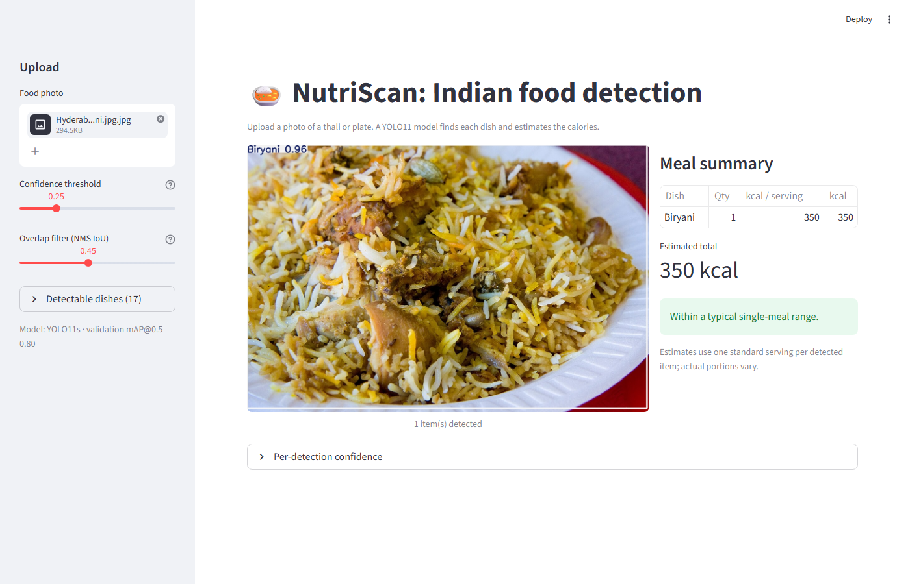

# 🍛 NutriScan


**Point a camera at an Indian meal and get each dish and its calories.** A YOLO11 object detector trained on 17 Indian dishes, served in a Streamlit app that runs on an ordinary laptop CPU.



## Results

Validation metrics from training (YOLO11s, 640 px, held-out validation split):

| Metric | Value |
|---|---|
| mAP@0.5 | **0.800** |
| mAP@0.5:0.95 | 0.587 |
| Precision | 0.774 |
| Recall | 0.743 |
| Classes | 17 |
| Parameters | 9.4 M |
| CPU inference (Intel i5-1235U laptop, 640 px) | **124 ms median**, 129 ms p90 |
| Model file | 19 MB |

Detectable dishes: Bhatura, Bhindi Masala, Biryani, Chole, Shahi Paneer, Chicken curry, Dal, Dhokla, Gulab Jamun, Idli, Jalebi, Modak, Palak Paneer, Poha, Rice, Roti, Samosa.

## How it works

```
photo ──► YOLO11s detector ──► boxes + class + confidence ──► NMS (IoU slider) ──► nutrition.summarize()
                                                                                      │
                                                     per-dish counts × kcal per serving ┘──► meal total + warning
```

- **Detector:** YOLO11s fine-tuned for 51 epochs on a Roboflow dataset of Indian dishes (1.3 h on one GPU).
- **Why detection, not classification:** a thali has many dishes. A classifier gives one label per photo. A detector finds and counts each item (3 rotis + dal + rice).
- **Overlap filter:** touching items (idlis, rotis) can produce duplicate boxes. The IoU slider controls non-max suppression so you can merge or separate them.
- **Calories** come from a per-serving table in [`nutrition.py`](nutrition.py), kept out of the UI so it is unit-tested.
- **Deployment-sized weights:** the training checkpoint (55 MB) carried optimizer state. Stripping it gives a 19 MB file with **identical predictions** (verified box-for-box).

## Run it

```bash
python -m venv venv
venv\Scripts\activate          # macOS/Linux: source venv/bin/activate
pip install -r requirements.txt
streamlit run app.py           # http://localhost:8501
```

No GPU needed.

## Tests

```bash
pip install -r requirements-dev.txt
pytest -q
```

They cover calorie maths, unknown labels and sorting, and a smoke test that loads the real weights, checks all 17 classes have a calorie value, and runs CPU inference.

## Known limitations

Tested on four photos from Wikimedia Commons that the model never saw:

| Photo | Result |
|---|---|
| Biryani | ✅ Biryani (0.96) |
| Chole bhature | ✅ Bhatura ×2 (0.92, 0.88); ❌ chole missed |
| Idli sambar | ❌ nothing detected |
| Samosa with chutney | ❌ detected as "chicken" (0.66) |

So the 0.80 validation mAP doesn't fully carry over to photos taken in different styles. Next steps:
- more varied training photos (lighting, plates, angles) and finishing the planned 100 epochs (training stopped at 51);
- **portion size:** calories assume one standard serving per detected item. Scaling by box area relative to the plate would be the next improvement.

Calorie values are approximate and not medical or dietary advice.

## Project layout

| Path | What |
|---|---|
| `app.py` | Streamlit UI |
| `nutrition.py` | calorie table and meal summary (pure Python, tested) |
| `models/nutriscan-yolo11s.pt` | trained weights (optimizer stripped) |
| `models/model_card.json` | training config and validation metrics |
| `tests/` | unit + model smoke tests |

---
Demo photo: "Hyderabadi Chicken Biryani" by Garrett Ziegler, [CC BY 2.0](https://creativecommons.org/licenses/by/2.0), via Wikimedia Commons.
